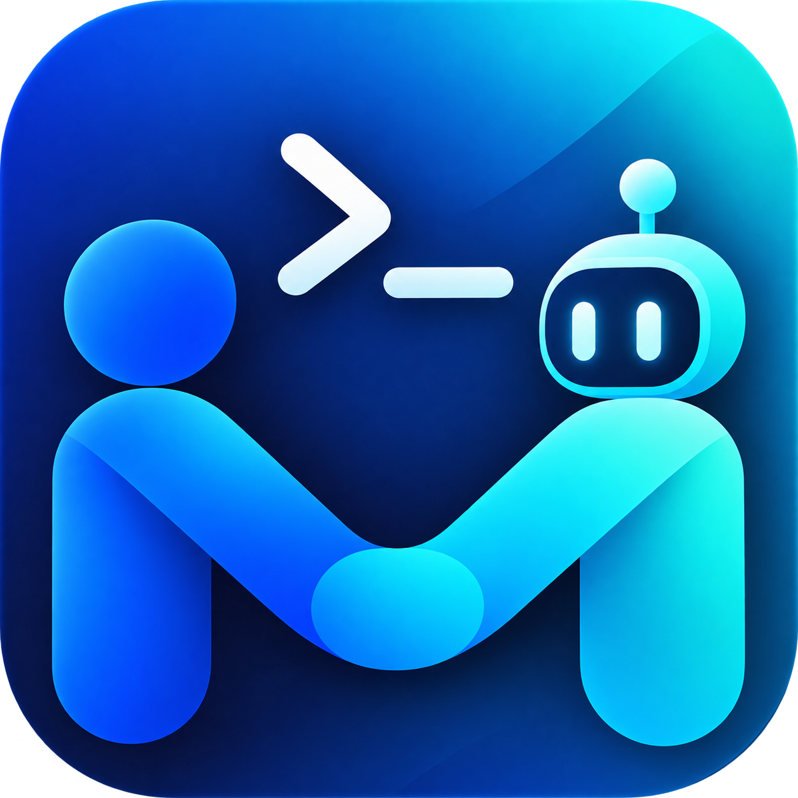
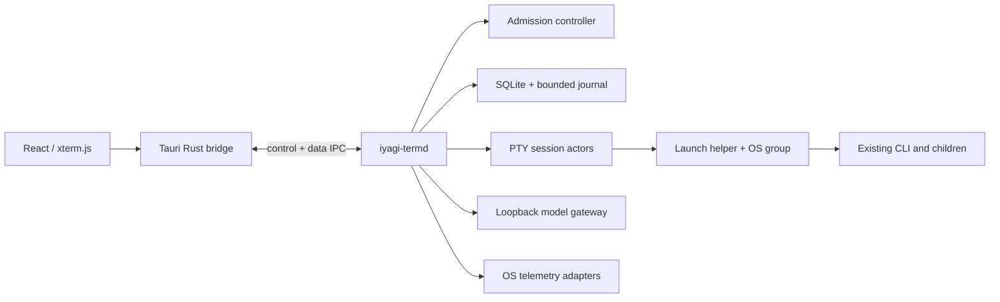

# IYAGI Terminal

**Your Interface to AGI** — Talk to AI. Build with AGI.

English | **[한국어](README_KR.md)** · [Download](#download) · [Release notes](RELEASE.md) ·
[How AI missions work](docs/orchestration/USER_GUIDE.md)



IYAGI Terminal is a desktop terminal that runs the AI coding CLIs you already use — **Claude
Code, Codex, OpenCode** — exactly as they are, and governs the machine resources they consume.

Model choice, LLM calls and conversations stay with each CLI. IYAGI owns everything underneath:
the PTYs, process groups, admission control, CPU/memory pressure and the sessions themselves,
through a user-privileged Rust daemon (`iyagi-termd`) that outlives the window. It is built on
Tauri 2 + React + xterm.js.

<p align="center">
  <a href="docs/media/iyagi-term-intro.mp4">
    
  </a>
  <br>
  <sub>30-second intro · <a href="docs/media/iyagi-term-intro.mp4">MP4, 1080p</a></sub>
</p>

## Download

Installers are published as **[GitHub Releases](https://github.com/sh2orc/iyagi-term/releases)**.

**Latest: [0.1.3](https://github.com/sh2orc/iyagi-term/releases/tag/v0.1.3)** (2026-10-13) — a
token usage observatory and kill switch for Z.ai-routed Claude Code terminals, API key pool
rotation, `Shift+Space` for Chinese and Japanese input sources, and a sharper WebGL renderer.
See [what's new](#whats-new-in-013).

<p align="center">
  <a href="https://github.com/sh2orc/iyagi-term/releases/latest">
    
  </a>
</p>

| Platform | File | Size | SHA-256 |
|---|---|---|---|
| macOS · Apple Silicon | [`IYAGI.Term_0.1.3_aarch64.dmg`](https://github.com/sh2orc/iyagi-term/releases/download/v0.1.3/IYAGI.Term_0.1.3_aarch64.dmg) | 17 MB | `fd80ffcf14cd470b919e26cc42fe5f3f321dedf155b01eb5d873ae193da6d8f3` |

Check the download before opening it:

```sh
shasum -a 256 ~/Downloads/IYAGI.Term_0.1.3_aarch64.dmg
```

The result must match the hash above, the hash in [RELEASE.md](RELEASE.md) and the digest
GitHub shows next to the asset on the release page.

<details>
<summary>Signing & trust on macOS</summary>

The app and the DMG are signed with a Developer ID, built with hardened runtime and notarized,
with the ticket stapled to the DMG, so it opens without Gatekeeper warnings — `spctl` reports
`source=Notarized Developer ID`.

Installers are still built and notarized on a release Mac rather than in CI. See
[releases/README.md](releases/README.md) for how a release is produced and for the release
integrity roadmap.
</details>

<details>
<summary>Other platforms & building from source</summary>

Only macOS (Apple Silicon) installers are published so far. CI
([.github/workflows/ci.yml](.github/workflows/ci.yml)) builds a Linux `.deb` and Windows/macOS
release binaries without installers.

From source: `npm ci && npm run tauri build` (see [Development](#development)).
</details>

<details>
<summary>Older versions</summary>

Every version is on the [releases page](https://github.com/sh2orc/iyagi-term/releases) with its
installer and notes. Until 0.1.2 the DMGs were committed under `releases/`; they now live only
as release assets.
</details>

## What's new in 0.1.3

- **Token usage observatory** (Settings › Integrations). Z.ai-routed Claude Code terminals can
  send their model requests through a loopback gateway in the daemon. It keeps a per-session
  token ledger and has a **kill switch** that refuses every routed request at once. Bodies are
  never stored, and the real API key never reaches the terminal. Off by default.
- **API key pool.** Register several Z.ai keys and the gateway rotates them per session
  (round-robin or fill-first). A rate-limited key rests while the same request moves on to the
  next key, and a key that fails authentication is set aside until you register it again.
- **`Shift+Space` for every CJK input source.** The input-source toggle now works with Chinese
  and Japanese input sources as well as Korean.
- **Regroup names tabs after their project.** Tabs are named after the project folder, with
  `-2`, `-3`… when two projects share a name.
- **WebGL renderer.** A fix that had been missing from the shipped bundle is back, so resizing
  no longer throws away and redraws the glyph atlas. A GPU that keeps losing contexts no longer
  makes panes flip between renderers.

After upgrading, open **Settings › General** and restart the daemon if it says a newer version is
installed — the gateway needs the 0.1.3 daemon. Full notes: [RELEASE.md](RELEASE.md).

## Quick start

1. Open the DMG and drag **IYAGI Term** into Applications.
2. Run `claude`, `codex` or `opencode` in any pane as you always do. IYAGI detects them by
   process and shows the agent, model and working/waiting state in the pane header.
3. Split with `Cmd+D` / `Cmd+Shift+D`. Open the command palette with `Cmd+Shift+P`, settings with
   `Cmd+,` and the managed-run queue with `Cmd+B`.
4. Close the window — terminals keep running in the daemon. Reopen the app and they reattach
   with their history.

> [!IMPORTANT]
> When IYAGI launches Claude Code or Codex for you — the one-click **quickstart cards** in an empty
> tab, managed runs and session resume — **full autonomy is on by default**. It adds
> `--dangerously-skip-permissions` (Claude Code) or `--dangerously-bypass-approvals-and-sandbox`
> (Codex), so the agent acts without asking for approval. Turn it off with the toggle beside the
> quickstart cards or under **Settings › Integrations**. A CLI you type into a pane yourself runs
> exactly as you typed it.

## Why IYAGI

Running several AI coding agents on one dev machine easily saturates CPU and memory. IYAGI
doesn't wrap another chat UI around that problem. It works below the conversation, at the OS
level, where the work actually runs:

- **Admission control.** Before a managed job starts, IYAGI checks telemetry freshness, host
  pressure, concurrency, CPU slots and memory headroom, and queues the job if needed. Waiting
  jobs gain priority as they age.
- **Whole process trees.** Each managed job is grouped **with its descendants** and can be
  stopped at once — Windows Job Objects, Linux cgroup v2 when a delegated subtree is available,
  and on macOS an independent guardian process plus an observed process tree. CPU, memory and
  process caps are enforced only where the OS supports them.
- **Pressure relief shares CPU instead of freezing it.** Background agents under CPU pressure,
  and any terminal that stays over its CPU limit, drop to a lower scheduling tier — never
  stopped — and come back when the pressure ends.
- **Resource guard for memory.** While host memory is under pressure, a terminal whose process
  tree stays over its memory limit is suspended. At critical pressure (under 1 GiB available, or
  when the kernel reports a crisis) the largest unfocused one goes first. They resume on their
  own, one at a time, once memory recovers. The session you are looking at and terminals you
  protect are never frozen automatically.
- **Sessions outlive the app.** The daemon owns the PTYs. Closing the window or quitting the
  app leaves terminals running, and reopening reattaches with a screen snapshot plus the journal
  tail instead of re-rendering the whole session.
- **Honest numbers.** Usage is attributed per process tree, and a value that can't be measured
  is shown as unknown with a reason — never as a fake `0`.

## Features

**Terminal workbench**

- Tabs and nested splits, up to 8 panes per tab (macOS `Cmd+D` / `Cmd+Shift+D`; Windows/Linux
  `Ctrl+Shift+D` / `Ctrl+Shift+E`). Drag dividers or move them with the arrow keys;
  double-click evens them out
- Shell picker with detected shells and a default shell
- Per-pane zoom (`Cmd/Ctrl` `=` `-` `0`), input broadcast to every pane in the tab
  (`Cmd+Shift+B` / `Ctrl+Shift+B`), and search over the scrollback or the whole session journal
  (`Cmd+F` / `Ctrl+Shift+F`)
- Command palette (`Cmd/Ctrl+Shift+P`), rebindable shortcuts, and a macOS menu bar that exposes
  every feature with live check marks and your shortcut overrides
- Right-click menu for links, clipboard, find, font size, split, broadcast, moving panes,
  copying the path or the agent resume command, restart and close. It also opens over TUIs that
  capture the mouse; `Shift`+right-click sends the click to the app instead
- **Regrouping.** Drag a pane header onto another pane (beside or swap), onto a tab, or between
  tabs; drag tabs to reorder or hold over one to merge. The layout editor (`Cmd+Shift+G`) shows
  every group as a card with a mini-map, and can regroup everything by Git repository after a
  preview — tabs are named after the project, with `-2`, `-3`… for duplicates
- Trackpad two-finger swipe between tabs (configurable)
- **Safe clipboard and links.** Pastes over 1 MiB are refused and control sequences stripped,
  bracketed paste is used only when the program enables it, program clipboard writes (OSC 52)
  are off by default, and only http(s) links open, through the OS opener
- **Images and files arrive as paths.** Paste a screenshot or drop files onto a pane and the
  terminal receives the path, so an AI CLI can read it. Clipboard images go to a temporary
  file that is cleaned up a day later
- Pane headers follow the program's title and working directory (OSC 0/2/7) and show the Git
  branch, CPU/RAM and replay or flow-control state
- WebGL rendering with a patched, vendored addon (12 concurrent contexts, retry on context
  loss) and a DOM fallback; Unicode 11 widths for Hangul jamo and emoji
- **Workspace restore.** Tabs, splits and live sessions come back on relaunch. Closing panes or
  quitting asks whether to keep the terminals running; the tray icon keeps them alive in the
  background

**AI agent awareness**

- Detects Claude Code, Codex and OpenCode in any pane by observing processes, not by scanning
  output. The pane header shows agent, session, model and effort, and panes, tabs and the
  window title carry working/waiting markers
- Ended sessions offer **Resume** in place, and the recent agent sessions dialog jumps to,
  resumes or forgets a session. On relaunch, restored panes resume their conversation — at most
  three at a time, and not while host memory is critical
- Notification center for permission requests, questions, finished responses and finished
  managed runs, with desktop notifications while the window is hidden. It works through
  Claude/Codex hooks and an injected OpenCode plugin — your global CLI config is never edited
- Subscription usage gauges for Codex, Claude and Z.ai in the status bar

**Z.ai routing, token observatory and key pool**

- One switch under **Settings › Integrations › Z.ai Coding Plan** routes Claude Code terminals
  (quickstart, Claude profiles, the `ccd`/`ccg` shell functions, resume and one-shot
  `claude-exec`) to Z.ai (GLM). The key lives in an encrypted local store (`term-secrets`,
  AES-256-GCM) and never enters a launch request
  ([guide](docs/orchestration/USER_GUIDE.md#claude-code-terminals--zai-glm))
- **Token usage observatory** (off by default): routed terminals go through a loopback
  gateway in the daemon, which meters tokens per session and offers a kill switch. Request and
  response bodies are never stored ([design](docs/implementation/08-local-gateway.md))
- **API key pool**: several keys rotate per session (round-robin or fill-first), with a
  cooldown after rate limits, quarantine after authentication errors, and one failover before
  the response starts streaming. Keys never change mid-conversation
  ([design](docs/implementation/09-key-pool-rotation.md))

**Korean and CJK input**

- A dedicated IME bridge for macOS WKWebView × xterm 6 delivers Korean 2-set input to the PTY
  exactly as typed, including right after startup and 한/영 switches
  ([contract](docs/implementation/07-korean-ime.md))
- `Shift+Space` toggles your enabled CJK input source (Korean, Chinese or Japanese) ↔ Latin on
  macOS (Auto / Always / Off); a balloon shows CapsLock 한/영 switches
- Bundled Korean coding font (Nanum Gothic Coding; D2Coding when installed) and UTF-8 PTY
  locale defaults

**Managed execution**

- Launch profiles (auto-discovery, compatibility matrix, JSON import/export) run your
  executables and arguments as-is
- Managed-run composer (Settings › Managed run) with priority, memory reservation and the
  autonomy toggle described in [Quick start](#quick-start)
- Queue drawer (`Cmd+B` / `Ctrl+B`) with wait reasons, cancel, attach and terminate
- Idempotent starts — replaying a request never launches the CLI twice
- One daemon and one app instance per user and data directory. Terminals outlive the window
  and the app, but not a daemon restart. **Settings › General** shows when the running daemon is
  older than the installed one and restarts it after a confirmation

**Resource governance & monitoring**

- Admission checks in a fixed order — telemetry freshness, host pressure, 2 concurrent managed
  jobs, CPU slots, reservation budget, memory headroom — with a 64-job queue whose priorities age
- Memory pressure from the kernel's own verdict (macOS memory-status level, Linux PSI) plus a
  1 GiB available floor; CPU pressure at 85 % / 95 % used. Thresholds ship inside the daemon
  ([defaults.json](docs/implementation/defaults.json))
- Resource strip with CPU, RAM and pressure, disk, network, the AI agents in your terminals and
  the managed queue, plus 5-minute graphs with per-metric source and quality labels
- Flow-controlled output (a slow view blocks only itself) and rolling session journals
  (128 MiB per session, 2 GiB in total, 7-day retention)

**AI missions (preview, development builds only)**

- Hand a goal to an AI team: a Lead conversation, task list, run details, a single decisions
  panel and result acceptance. Underneath is a daemon engine with plan validation, DAG
  scheduling, isolated Git worktrees, budget gates and recovery, plus Codex, Claude Code and
  OpenCode adapters
- Quick setup detects installed runtimes and models and builds a four-role team in one click
- Off in release builds. A full real-model mission has passed end to end on macOS with a Codex
  subscription ([evidence](docs/orchestration/CODEX_MACOS_MISSION_01540.md),
  [how it works](docs/orchestration/USER_GUIDE.md))

**Settings & appearance**

- Searchable settings: General, Terminal, Integrations, Managed run, Launch profiles, Keyboard
  shortcuts and Compatibility
- System / Dark / Light themes that follow the OS live; Korean and English UI

## Architecture



```text
src/                  React app (tabs, split terminals, missions, monitor, queue, settings, profiles)
src-tauri/            Tauri shell (window, tray, detached daemon spawn, IPC bridge)
crates/
  term-contracts/     Cross-layer types, validation, TS generation (dependency hub)
  term-core/          State machines, admission, queueing, idempotency, mission planning (pure logic)
  term-platform/      OS resource groups (Linux cgroup / Windows Job / macOS guardian), telemetry
  term-pty/           PTY session actors, MTJ1 journal, output flow control, launch gates
  term-storage/       SQLite metadata, migrations, fingerprints, crash recovery
  term-secrets/       App-local encrypted secret store and key pool (AES-256-GCM, owner-only files)
  iyagi-termd/        Execution manager daemon, launch helper, agent watch, gateway, mission service
  term-fixture/       Deterministic load and protocol fixtures (not in the product bundle)
  iyagi-bench/        Benchmark harness over the real daemon (latency, idle, flood, queue, replay)
```

Dependencies point `UI → bridge → contracts → core`. `term-core` reaches platform, PTY and
storage through traits and never references Tauri or React. Resource-admission truth lives in
exactly one place — the daemon.

**Tech stack:** React 18 · TypeScript 5.9 · xterm.js 6 · Zustand 4 · Vite 5 · Vitest 2 ·
Playwright · Tauri 2.11 · Rust 2021 (tokio, portable-pty, rusqlite, sysinfo, ts-rs).

## Development

Requirements: Rust ≥ 1.89 (MSRV), Node 22 LTS, Python 3. Targets: macOS arm64/x86_64, Windows
x86_64, Linux x86_64. Lockfiles are committed; CI uses `npm ci` and `cargo --locked`.

```sh
npm ci
npm run tauri dev                            # stage a debug daemon, start Vite and the app

npm run typecheck && npm run test:unit       # TS + vitest unit tests
npm run test:mission-ui                      # Playwright mission UI tests against a mock daemon
cargo fmt --all --check
cargo clippy --workspace --all-targets --locked -- -D warnings
cargo test --workspace --locked
python3 scripts/smoke_e2e.py                 # E2E smoke against the real daemon binary
python3 docs/orchestration/verify_spec.py    # mission spec asset/link checks
npm run tauri build                          # bundle the app
```

<details>
<summary>Stable code signing for local macOS builds</summary>

`npm run tauri dev|build` signs local builds with a keychain identity named `iyagi-dev` when
one exists (`scripts/tauri.mjs`; set `IYAGI_SIGNING_IDENTITY` to use another, `-` to stay
ad-hoc). Ad-hoc signatures change on every build, so macOS asks for privacy grants such as
"would like to access data from other apps" again after each rebuild; a stable identity keeps
them. Create one in Keychain Access → Certificate Assistant → Create a Certificate… (Identity
Type: Self Signed Root, Certificate Type: Code Signing). Hosts without it, such as CI, ad-hoc
sign the whole bundle.
</details>

<details>
<summary>Windows hosts without a complete MSVC setup</summary>

Run `source scripts/dev-env.sh` before cargo in Git Bash (GNU toolchain + w64devkit).
</details>

<details>
<summary>Linux verification image</summary>

Tests that depend on Linux behavior — PTY actors, cgroup paths, process groups, gate helpers —
should run on real Linux. From a macOS host, use the Docker image instead of cross-compiling:

```sh
docker build --platform linux/arm64 -t iyagi-ubuntu:24.04 scripts/docker/ubuntu-24.04
docker run --rm --platform linux/arm64 \
  -v "$PWD":/work -v iyagi-termd-target:/work/target -v iyagi-termd-cargo:/cache/cargo-home \
  -e CARGO_TARGET_DIR=/work/target \
  iyagi-ubuntu:24.04 bash -lc 'cd /work && cargo test --workspace --locked'
```

The named volumes keep build and cargo caches between runs. `--platform linux/arm64` is for
Apple Silicon; omit it on x86_64 hosts. The image pins Rust 1.89, the workspace MSRV.
</details>

### Releasing

Releases are tagged `v<version>` and published as GitHub Releases with the signed, notarized
DMG attached; installers are no longer committed to the repository. The full checklist — version
bump, build, notarization, `gh release create` — is in [releases/README.md](releases/README.md).

## Documentation

| Document | Content |
|---|---|
| [docs/orchestration/USER_GUIDE.md](docs/orchestration/USER_GUIDE.md) (+ KR, details) | How AI missions work — setup, decisions, recovery |
| [ORCHESTRATION_SPEC.md](ORCHESTRATION_SPEC.md) + [docs/orchestration/](docs/orchestration/) | Mission engine spec, tickets, and [implementation status](docs/orchestration/IMPLEMENTATION_STATUS.md) |
| [docs/implementation/07-korean-ime.md](docs/implementation/07-korean-ime.md) | Korean/CJK IME bridge contract (macOS WKWebView × xterm) |
| [docs/implementation/08-local-gateway.md](docs/implementation/08-local-gateway.md) | Loopback observability gateway and kill switch (Korean) |
| [docs/implementation/09-key-pool-rotation.md](docs/implementation/09-key-pool-rotation.md) | API key pool and rotation engine (Korean) |
| [docs/implementation/resource-governance-plan.md](docs/implementation/resource-governance-plan.md) | Resource guard and pressure relief design and thresholds (Korean) |
| [docs/security/](docs/security/) | Security audit records |
| [RELEASE.md](RELEASE.md) | Release notes for every version |
| [releases/README.md](releases/README.md) | How releases are built, signed, notarized and published |

## Status & Roadmap

**0.1.3** is the current release. **R1 — local terminal + managed execution** has shipped since
0.1.0, and each release since has refined resource governance, agent awareness and input; see
[RELEASE.md](RELEASE.md) for the history.

- **O1 — AI missions: implemented behind a development-build gate.** The daemon engine,
  storage, RPC, adapters and the full mission UI are in place, and a complete real-model mission
  (plan → two builders → integration → sandboxed verification → independent review →
  acceptance) has passed on macOS. Still open: enabling it in release builds, compatibility
  evidence for other CLI/OS/authentication combinations, Windows native recovery and the items
  in [implementation status](docs/orchestration/IMPLEMENTATION_STATUS.md)
- **Gateway Phase 2–3** — Codex traffic observation, then quota-aware account pools behind an
  explicit opt-in ([roadmap](docs/implementation/09-key-pool-rotation.md))
- **R2** — remote execution over SSH, terminal state checkpoints, per-CLI deep integration
- **R3** — task DAGs with explicit completion conditions, verified shared tool services

## The name

IYAGI reads as *iyagi* — 이야기, the Korean word for "story" — with **AGI** hiding in plain sight:

```text
IY AGI
   ───
```

You don't merely issue commands to AI — you talk with it, and it thinks and executes alongside
you. You never handle AGI bare-handed: you work with it through an interface. IYAGI Terminal is
the first product of that family:

```text
IYAGI Terminal     → AI Coding / Agentic Engineering   (this repository)
IYAGI Workspace    → Knowledge / Work
IYAGI Agent        → Autonomous Tasks
IYAGI Studio       → Build & Orchestrate Agents
```

## License

Apache-2.0. See [LICENSE.md](LICENSE.md).
