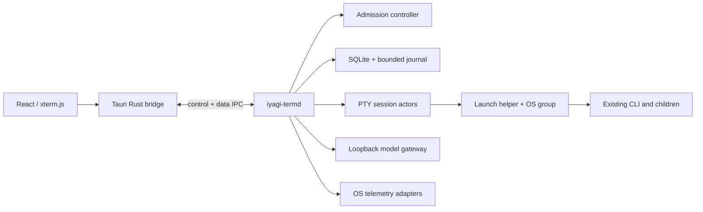

# IYAGI Terminal

**Your Interface to AGI** — Talk to AI. Build with AGI.

한국어 | **[English](README.md)** · [다운로드](#다운로드) · [릴리스 노트](RELEASE.md) ·
[AI 작업 사용법](docs/orchestration/USER_GUIDE_KR.md)


IYAGI Terminal은 이미 쓰고 있는 AI 코딩 CLI — **Claude Code, Codex, OpenCode** — 를 그대로
실행하면서, 그 CLI들이 쓰는 머신 자원을 관리하는 데스크톱 터미널입니다.

모델 선택·LLM 호출·대화는 각 CLI가 계속 맡습니다. IYAGI는 그 아래 전부 — PTY, 프로세스 그룹,
admission 제어, CPU·메모리 압력, 세션 자체 — 를 창보다 오래 사는 사용자 권한 Rust 데몬
(`iyagi-termd`)으로 소유합니다. Tauri 2 + React + xterm.js로 만들었습니다.

<p align="center">
  <a href="docs/media/iyagi-term-intro.mp4">
    
  </a>
  <br>
  <sub>30초 소개 영상(영어) · <a href="docs/media/iyagi-term-intro.mp4">MP4, 1080p</a></sub>
</p>

## 다운로드

설치 파일은 **[GitHub Releases](https://github.com/sh2orc/iyagi-term/releases)**로 배포합니다.

**최신: [0.1.4](https://github.com/sh2orc/iyagi-term/releases/tag/v0.1.4)** (2026-10-16) — 유지보수
릴리스: macOS에서 문자 키를 누르고 있으면 반복 입력되어 vim의 `h`/`j`/`k`/`l`로 계속 이동합니다.
0.1.3에서는 Z.ai로 라우팅된 Claude Code 터미널의 토큰 사용량 관측과 킬 스위치, API 키 풀 회전,
중국어·일본어 입력 소스용 `Shift+Space`가 들어왔습니다. [새로운 점](#014의-새로운-점)을 참고하세요.

<p align="center">
  <a href="https://github.com/sh2orc/iyagi-term/releases/latest">
    
  </a>
</p>

| 플랫폼 | 파일 | 크기 | SHA-256 |
|---|---|---|---|
| macOS · Apple Silicon | [`IYAGI.Term_0.1.4_aarch64.dmg`](https://github.com/sh2orc/iyagi-term/releases/download/v0.1.4/IYAGI.Term_0.1.4_aarch64.dmg) | 17 MB | `ea644c56831fb3f6d99fc77d3b33af1fefecba3f9e3312692870a5878b93c4b1` |

열기 전에 받은 파일을 확인하세요.

```sh
shasum -a 256 ~/Downloads/IYAGI.Term_0.1.4_aarch64.dmg
```

결과가 위 해시, [RELEASE.md](RELEASE.md)의 해시, 릴리스 페이지에서 GitHub가 첨부 파일 옆에 보여
주는 digest와 모두 같아야 합니다.

<details>
<summary>macOS 서명과 신뢰</summary>

앱과 DMG는 Developer ID로 서명하고 hardened runtime으로 빌드해 공증했으며, 티켓을 DMG에
스테이플했습니다. 그래서 Gatekeeper 경고 없이 열립니다 — `spctl`은 `source=Notarized Developer ID`로
판정합니다.

설치 파일은 아직 CI가 아니라 릴리스용 Mac에서 빌드·공증합니다. 릴리스를 만드는 절차와 릴리스
무결성 로드맵은 [releases/README.md](releases/README.md)를 참고하세요.
</details>

<details>
<summary>다른 플랫폼과 소스 빌드</summary>

지금은 macOS(Apple Silicon) 설치 파일만 배포합니다. CI([.github/workflows/ci.yml](.github/workflows/ci.yml))는
Linux `.deb`와 Windows/macOS 릴리스 바이너리(설치 파일 없음)를 만듭니다.

소스에서 직접 빌드: `npm ci && npm run tauri build` ([개발](#개발) 참고).
</details>

<details>
<summary>이전 버전</summary>

모든 버전의 설치 파일과 노트는 [릴리스 페이지](https://github.com/sh2orc/iyagi-term/releases)에
있습니다. 0.1.2까지는 DMG를 저장소의 `releases/`에 커밋했지만, 이제는 릴리스 첨부 파일로만
배포합니다.
</details>

## 0.1.4의 새로운 점

- **macOS에서 길게 누른 키 반복.** 문자 키를 누르고 있으면(vim의 `h`/`j`/`k`/`l` 등) 한 번만
  움직이고 멈추던 문제를 고쳤습니다. 이제 방향키처럼 계속 반복됩니다. 전체 노트:
  [RELEASE.md](RELEASE.md).

## 0.1.3의 새로운 점

- **토큰 사용량 관측**(설정 › 연동). Z.ai로 라우팅된 Claude Code 터미널의 모델 요청이 데몬의
  루프백 게이트웨이를 한 번 거쳐 가게 할 수 있습니다. 세션별 토큰 장부를 남기고, 라우팅된 요청을
  한 번에 모두 거절하는 **킬 스위치**를 제공합니다. 본문은 저장하지 않고 실제 API 키는 터미널에
  실리지 않습니다. 기본은 꺼짐입니다.
- **API 키 풀.** Z.ai 키를 여러 개 등록하면 게이트웨이가 세션 단위로 돌려 씁니다(라운드 로빈 또는
  채워 쓰기). 한도에 걸린 키는 잠시 쉬고 같은 요청은 다음 키로 이어지며, 인증에 실패한 키는 다시
  등록할 때까지 뺍니다.
- **모든 CJK 입력 소스에서 `Shift+Space`.** 한국어뿐 아니라 중국어·일본어 입력 소스와도 영문을
  오가며 전환합니다.
- **다시 묶은 탭에 프로젝트 이름.** 탭 이름이 프로젝트 폴더 이름이 되고, 이름이 겹치면 `-2`,
  `-3`…을 붙입니다.
- **WebGL 렌더러.** 배포 번들에서 빠져 있던 수정을 다시 넣어, 창 크기를 바꿀 때마다 글리프
  아틀라스를 버리고 다시 그리지 않습니다. 컨텍스트를 계속 잃는 GPU에서 pane이 렌더러 사이를
  오가며 깜빡이지 않습니다.

업그레이드한 뒤 **설정 › 일반**에서 더 새 버전이 설치되어 있다고 나오면 데몬을 재시작하세요 —
게이트웨이는 0.1.3 데몬이 필요합니다. 전체 노트: [RELEASE.md](RELEASE.md).

## 빠른 시작

1. DMG를 열고 **IYAGI Term**을 응용 프로그램(Applications) 폴더로 끌어 놓습니다.
2. 어느 pane에서든 평소처럼 `claude`·`codex`·`opencode`를 실행합니다. IYAGI가 프로세스로 감지해
   pane 헤더에 에이전트·모델·작업 중/응답 대기 상태를 보여 줍니다.
3. `Cmd+D` / `Cmd+Shift+D`로 분할합니다. `Cmd+Shift+P`로 커맨드 팔레트, `Cmd+,`로 설정,
   `Cmd+B`로 관리 실행 대기열을 엽니다.
4. 창을 닫아도 터미널은 데몬에서 계속 실행됩니다. 앱을 다시 열면 기록과 함께 다시 붙습니다.

> [!IMPORTANT]
> IYAGI가 대신 Claude Code나 Codex를 실행할 때 — 빈 탭의 원클릭 **빠른 시작 카드**, 관리 실행,
> 세션 재개 — **완전 자율 권한이 기본으로 켜져 있습니다**. `--dangerously-skip-permissions`
> (Claude Code)나 `--dangerously-bypass-approvals-and-sandbox`(Codex)를 붙이므로 에이전트가
> 승인을 묻지 않고 작업합니다. 승인 확인을 원하면 빠른 시작 카드 옆 토글이나 **설정 › 연동**에서
> 끄세요. pane에 직접 입력한 CLI는 입력한 그대로 실행됩니다.

## 왜 IYAGI인가

개발 PC 하나에 AI 코딩 에이전트 여러 개를 돌리면 CPU와 메모리가 금방 포화됩니다. IYAGI는 또
하나의 채팅 UI를 씌우는 대신, 대화 아래 — 실제 작업이 도는 OS 수준 — 에서 문제를 다룹니다.

- **Admission 제어.** 관리 작업을 시작하기 전에 텔레메트리 신선도·호스트 압력·동시 실행 수·CPU
  슬롯·메모리 여유를 확인하고, 필요하면 대기열에 넣습니다. 기다리는 작업은 시간이 지날수록
  우선순위가 오릅니다.
- **프로세스 트리 전체.** 관리 작업을 **자손까지** 묶어 한 번에 멈출 수 있습니다 — Windows Job
  Object, 위임된 서브트리가 있을 때의 Linux cgroup v2, macOS는 독립 guardian 프로세스와 프로세스
  트리 관측. CPU·메모리·프로세스 수 상한은 OS가 지원하는 곳에서만 강제합니다.
- **압력 완화는 CPU를 얼리지 않고 나눠 씁니다.** CPU 압력이 높을 때의 백그라운드 에이전트와 CPU
  한도를 계속 넘는 터미널은 낮은 스케줄링 등급으로 내려갈 뿐 멈추지 않고, 압력이 끝나면 돌아옵니다.
- **메모리는 자원 가드가 다룹니다.** 호스트 메모리에 압력이 있을 때 프로세스 트리의 메모리가
  한도를 계속 넘는 터미널을 일시 정지합니다. 치명적 압력(가용 1 GiB 미만, 또는 커널이 위기를
  알릴 때)에서는 포커스 없는 최대 소비자부터 정지하고, 메모리가 회복되면 하나씩 스스로
  재개합니다. 보고 있는 세션과 사용자가 보호한 터미널은 자동으로 정지하지 않습니다.
- **세션이 앱보다 오래 삽니다.** PTY는 데몬이 소유합니다. 창을 닫거나 앱을 종료해도 터미널은
  계속 돌고, 다시 열면 전체를 다시 그리는 대신 화면 스냅숏과 저널 꼬리로 다시 붙습니다.
- **정직한 숫자.** 사용량은 프로세스 트리 단위로 집계하고, 측정할 수 없는 값은 사유와 함께
  '측정 불가'로 표시합니다. `0`으로 꾸미지 않습니다.

## 기능

**터미널 워크벤치**

- 탭과 중첩 분할, 탭당 최대 8개 pane(macOS `Cmd+D` / `Cmd+Shift+D`, Windows/Linux `Ctrl+Shift+D` /
  `Ctrl+Shift+E`). 분할선은 끌거나 방향키로 옮기고, 더블클릭하면 균등 분할합니다
- 감지된 셸과 기본 셸을 고르는 셸 선택기
- pane별 확대/축소(`Cmd/Ctrl` `=` `-` `0`), 탭의 모든 pane 동시 입력(`Cmd+Shift+B` /
  `Ctrl+Shift+B`), scrollback 또는 세션 저널 전체 검색(`Cmd+F` / `Ctrl+Shift+F`)
- 커맨드 팔레트(`Cmd/Ctrl+Shift+P`), 다시 지정할 수 있는 단축키, 모든 기능을 체크 표시와 사용자
  단축키까지 반영해 보여 주는 macOS 메뉴 막대
- 우클릭 메뉴: 링크, 클립보드, 찾기, 글꼴 크기, 분할, 동시 입력, pane 이동, 경로·에이전트 재개
  명령 복사, 다시 시작, 닫기. 마우스를 잡는 TUI 위에서도 열리고, `Shift`+우클릭은 클릭을 앱으로
  보냅니다
- **다시 묶기.** pane 헤더를 다른 pane(옆에 놓기·자리 바꾸기), 탭 위, 탭 사이로 끌어 옮기고, 탭을
  끌어 순서를 바꾸거나 탭 위에 머물러 합칩니다. 배치 편집 화면(`Cmd+Shift+G`)은 그룹마다 미니맵
  카드를 보여 주고, 미리보기 후 Git 저장소별로 한 번에 다시 묶습니다 — 탭 이름은 프로젝트 이름이며
  겹치면 `-2`, `-3`…을 붙입니다
- 트랙패드 두 손가락 스와이프로 탭 전환(설정 가능)
- **안전한 클립보드·링크.** 1 MiB 넘는 붙여넣기는 거절하고 제어 시퀀스를 걸러 내며, 괄호
  붙여넣기는 프로그램이 켰을 때만 쓰고, 프로그램의 클립보드 쓰기(OSC 52)는 기본으로 막고,
  링크는 http(s)만 OS 기본 앱으로 엽니다
- **이미지·파일은 경로로.** 스크린샷을 붙여넣거나 파일을 pane에 떨어뜨리면 그 경로가 터미널에
  입력되어 AI CLI가 바로 읽습니다. 클립보드 그림은 임시 파일로 저장하고 하루 뒤 치웁니다
- pane 헤더가 프로그램이 정한 제목·작업 디렉터리(OSC 0/2/7)를 따르고 Git 브랜치·CPU/RAM·재생/흐름
  제어 상태를 보여 줍니다
- 패치한 번들 애드온의 WebGL 렌더링(동시 컨텍스트 12개, 컨텍스트 손실 시 재시도)과 DOM 폴백,
  한글 자모·이모지 폭의 Unicode 11 적용
- **작업 공간 복원.** 다시 실행하면 탭·분할·살아 있는 세션이 돌아옵니다. pane을 닫거나 앱을 종료할
  때 터미널을 계속 실행할지 묻고, 트레이 아이콘으로 백그라운드에서 유지합니다

**AI 에이전트 인식**

- 어느 pane에서든 Claude Code·Codex·OpenCode를 출력이 아니라 프로세스 관측으로 감지합니다. pane
  헤더에 에이전트·세션·모델·effort를 보여 주고, pane·탭·창 제목에 작업 중/응답 대기 표시를 붙입니다
- 끝난 세션은 그 자리에서 **이어서 열기**를 제공하고, 최근 에이전트 세션 대화상자에서 이동·재개·
  기록 삭제를 합니다. 다시 실행하면 복원된 pane이 대화를 이어서 엽니다 — 동시에 최대 3개씩,
  호스트 메모리가 치명적일 때는 기다립니다
- 권한 요청·질문·응답 완료·관리 실행 종료를 모으는 알림 센터, 창이 숨어 있으면 데스크톱 알림.
  Claude/Codex hooks와 주입형 OpenCode 플러그인으로 동작하며 CLI 전역 설정은 건드리지 않습니다
- 상태 표시줄의 Codex·Claude·Z.ai 구독 사용량 게이지. 팝오버는 창별 사용량과 초기화 시각을
  보여주되 분 단위로 올립니다 — 공급자의 창은 16:59:59처럼 초 단위 경계에서 돌아가고,
  claude.ai 등 자체 대시보드도 17:00으로 올려 표기합니다

**Z.ai 라우팅, 토큰 관측, 키 풀**

- **설정 › 연동 › Z.ai Coding Plan**의 스위치 하나로 Claude Code 터미널(빠른 시작, Claude 프로필,
  `ccd`/`ccg` 셸 함수, 재개, 일회성 `claude-exec`)을 Z.ai(GLM)로 라우팅합니다. 키는 로컬 암호화
  저장소(`term-secrets`, AES-256-GCM)에 있고 실행 요청에는 들어가지 않습니다
  ([안내](docs/orchestration/USER_GUIDE_KR.md#claude-code-터미널--zaiglm))
- **토큰 사용량 관측**(기본 꺼짐): 라우팅된 터미널이 데몬의 루프백 게이트웨이를 거쳐 가며, 세션별
  토큰을 계량하고 킬 스위치를 제공합니다. 요청·응답 본문은 저장하지 않습니다
  ([설계](docs/implementation/08-local-gateway.md))
- **API 키 풀**: 여러 키를 세션 단위로 돌려 씁니다(라운드 로빈 또는 채워 쓰기). 한도에 걸리면
  쿨다운, 인증 오류면 격리하고, 응답 스트림이 시작되기 전에 한 번 다음 키로 넘깁니다. 대화
  중간에는 키가 바뀌지 않습니다 ([설계](docs/implementation/09-key-pool-rotation.md))

**한글·CJK 입력**

- macOS WKWebView × xterm 6 환경에서 한글(두벌식) 입력이 친 그대로 PTY에 도달하도록 하는 전용 IME
  브리지. 시작 직후와 한/영 전환 직후에도 정확합니다
  ([계약](docs/implementation/07-korean-ime.md))
- macOS에서 `Shift+Space`로 켜 둔 CJK 입력 소스(한국어·중국어·일본어) ↔ 영문 전환(자동·항상·끄기),
  CapsLock 한/영 전환 시 풍선 표시
- 한글 코딩 폰트 번들(나눔고딕코딩, D2Coding이 설치돼 있으면 우선)과 PTY UTF-8 로케일 기본값

**관리 실행**

- 실행 프로필(자동 발견, 호환 매트릭스, JSON 가져오기/내보내기)이 등록한 실행 파일과 인수를
  그대로 실행합니다
- 관리 실행 컴포저(설정 › 관리 실행): 우선순위, 메모리 예약, [빠른 시작](#빠른-시작)에서 설명한
  자율 권한 토글
- 대기열 drawer(`Cmd+B` / `Ctrl+B`): 대기 사유, 취소, 터미널 연결, 종료
- 멱등 시작 — 같은 요청을 다시 보내도 CLI를 두 번 실행하지 않습니다
- 사용자·데이터 디렉터리당 데몬 하나와 앱 인스턴스 하나. 터미널은 창·앱을 닫아도 살지만 데몬
  재시작은 넘기지 못합니다. **설정 › 일반**에서 실행 중인 데몬이 설치된 버전보다 오래됐는지
  보여 주고 확인을 거쳐 재시작합니다

**자원 거버넌스·모니터링**

- 정해진 순서의 admission 검사 — 텔레메트리 신선도, 호스트 압력, 관리 작업 동시 2개, CPU 슬롯,
  예약 예산, 메모리 여유 — 와 우선순위가 나이 드는 64개 대기열
- 메모리 압력은 커널 자체 판정(macOS memory-status 수준, Linux PSI)과 가용 1 GiB 하한으로, CPU
  압력은 사용률 85% / 95%로 판정합니다. 임계값은 데몬에 내장됩니다
  ([defaults.json](docs/implementation/defaults.json))
- CPU, RAM·압력, 디스크, 네트워크, 터미널의 AI 에이전트, 관리 대기열을 보여 주는 자원 스트립과
  지표별 출처·품질 라벨이 붙은 5분 그래프
- 흐름 제어가 있는 출력(느린 뷰는 자기만 막힘)과 순환하는 세션 저널(세션당 128 MiB, 전체 2 GiB,
  7일 보존)

**AI 작업(미리보기, 개발 빌드 전용)**

- 목표를 AI 팀에 맡깁니다: Lead 대화, 할 일 목록, 실행 상세, 하나로 모인 결정 패널, 결과 확정.
  그 아래에는 계획 검증, DAG 스케줄링, 격리된 Git worktree, 예산 게이트와 복구를 갖춘 데몬 엔진과
  Codex·Claude Code·OpenCode 어댑터가 있습니다
- 빠른 설정이 설치된 런타임과 모델을 감지해 한 번에 4역할 팀을 만듭니다
- 릴리스 빌드에서는 꺼져 있습니다. macOS Codex 구독으로 실제 모델 전체 흐름이 종단 검증되었습니다
  ([증거](docs/orchestration/CODEX_MACOS_MISSION_01540.md), [사용법](docs/orchestration/USER_GUIDE_KR.md))

**설정·화면**

- 검색되는 설정: 일반, 터미널, 연동, 관리 실행, 실행 프로필, 단축키, 호환성
- OS 설정을 바로 따르는 시스템·어둡게·밝게 테마, 한국어/영어 UI

## 아키텍처



```text
src/                  React 앱 (탭·분할 터미널·AI 작업·모니터·대기열·설정·프로필)
src-tauri/            Tauri 셸 (창·트레이, 데몬 분리 spawn, IPC 브리지)
crates/
  term-contracts/     계층 간 타입·검증·TS 생성 (의존 방향의 한가운데)
  term-core/          상태 머신·admission·대기열·멱등·AI 작업 계획 (순수 로직)
  term-platform/      OS 자원 그룹(Linux cgroup/Windows Job/macOS guardian)·텔레메트리
  term-pty/           PTY 세션 액터·MTJ1 저널·출력 흐름 제어·실행 게이트
  term-storage/       SQLite 메타데이터·마이그레이션·지문·크래시 복구
  term-secrets/       앱 로컬 암호화 비밀 저장소와 키 풀 (AES-256-GCM, 소유자 전용 파일)
  iyagi-termd/        실행 관리자 데몬·launch helper·에이전트 감시·게이트웨이·AI 작업 서비스
  term-fixture/       검증용 결정적 부하·프로토콜 fixture (제품 번들 제외)
  iyagi-bench/        실제 데몬 대상 벤치마크 하니스 (latency, idle, flood, queue, replay)
```

의존 방향은 `UI → bridge → contracts → core`입니다. `term-core`는 trait로 platform·pty·storage를
쓰며 Tauri나 React를 참조하지 않습니다. 자원 판정의 정답은 데몬 한 곳에만 있습니다.

**기술 스택:** React 18 · TypeScript 5.9 · xterm.js 6 · Zustand 4 · Vite 5 · Vitest 2 ·
Playwright · Tauri 2.11 · Rust 2021 (tokio, portable-pty, rusqlite, sysinfo, ts-rs).

## 개발

요구 사항: Rust 1.89 이상(MSRV), Node 22 LTS, Python 3. 대상: macOS arm64/x86_64, Windows x86_64,
Linux x86_64. lockfile을 커밋하며 CI는 `npm ci`와 `cargo --locked`를 씁니다.

```sh
npm ci
npm run tauri dev                            # 디버그 데몬 스테이징 후 Vite와 앱 실행

npm run typecheck && npm run test:unit       # TS + vitest 단위 시험
npm run test:mission-ui                      # Playwright AI 작업 UI 시험 (mock 데몬)
cargo fmt --all --check
cargo clippy --workspace --all-targets --locked -- -D warnings
cargo test --workspace --locked
python3 scripts/smoke_e2e.py                 # 실제 데몬 바이너리 E2E 스모크
python3 docs/orchestration/verify_spec.py    # AI 작업 명세 자산·링크 검사
npm run tauri build                          # 번들
```

<details>
<summary>로컬 macOS 빌드의 고정 코드 서명</summary>

키체인에 `iyagi-dev`라는 인증서가 있으면 `npm run tauri dev|build`가 로컬 빌드를 그 인증서로
서명합니다(`scripts/tauri.mjs`; 다른 인증서는 `IYAGI_SIGNING_IDENTITY`로 지정하고 `-`면 ad-hoc 유지).
ad-hoc 서명은 빌드마다 바뀌어 "다른 앱의 데이터에 접근" 같은 macOS 개인정보 보호 허용을 다시 빌드할
때마다 또 묻지만, 고정 인증서면 허용이 유지됩니다. 인증서는 키체인 접근 → 인증서 지원 → 인증서
생성…에서 만듭니다(신원 유형: 자체 서명 루트, 인증서 유형: 코드 서명). CI처럼 인증서가 없는
환경은 번들 전체를 ad-hoc으로 서명합니다.
</details>

<details>
<summary>MSVC가 불완전한 Windows 호스트</summary>

Git Bash에서 cargo 실행 전에 `source scripts/dev-env.sh`를 실행합니다(GNU 툴체인 + w64devkit).
</details>

<details>
<summary>Linux 검증 이미지</summary>

Linux 동작에 의존하는 시험 — PTY 액터, cgroup 경로, 프로세스 그룹, 게이트 헬퍼 — 은 실제
Linux에서 돌려야 합니다. macOS 호스트에서는 교차 컴파일 대신 Docker 이미지를 씁니다.

```sh
docker build --platform linux/arm64 -t iyagi-ubuntu:24.04 scripts/docker/ubuntu-24.04
docker run --rm --platform linux/arm64 \
  -v "$PWD":/work -v iyagi-termd-target:/work/target -v iyagi-termd-cargo:/cache/cargo-home \
  -e CARGO_TARGET_DIR=/work/target \
  iyagi-ubuntu:24.04 bash -lc 'cd /work && cargo test --workspace --locked'
```

네임드 볼륨이 빌드·cargo 캐시를 실행 사이에 유지합니다. `--platform linux/arm64`는 Apple
Silicon용이며 x86_64 호스트에서는 생략합니다. 이미지는 워크스페이스 MSRV인 Rust 1.89를 고정합니다.
</details>

### 릴리스

릴리스는 `v<버전>` 태그를 달고, 서명·공증한 DMG를 첨부한 GitHub Release로 배포합니다. 설치 파일은
더 이상 저장소에 커밋하지 않습니다. 버전 올리기, 빌드, 공증, `gh release create`까지의 전체
절차는 [releases/README.md](releases/README.md)에 있습니다.

## 문서

| 문서 | 내용 |
|---|---|
| [docs/orchestration/USER_GUIDE_KR.md](docs/orchestration/USER_GUIDE_KR.md) (+ EN, 상세) | AI 작업 사용법 — 설정, 결정, 복구 |
| [ORCHESTRATION_SPEC.md](ORCHESTRATION_SPEC.md) + [docs/orchestration/](docs/orchestration/) | AI 작업 엔진 명세·티켓과 [구현 상태](docs/orchestration/IMPLEMENTATION_STATUS.md) |
| [docs/implementation/07-korean-ime.md](docs/implementation/07-korean-ime.md) | 한글·CJK IME 브리지 계약 (macOS WKWebView × xterm) |
| [docs/implementation/08-local-gateway.md](docs/implementation/08-local-gateway.md) | 루프백 관측 게이트웨이와 킬 스위치 |
| [docs/implementation/09-key-pool-rotation.md](docs/implementation/09-key-pool-rotation.md) | API 키 풀과 회전 엔진 |
| [docs/implementation/resource-governance-plan.md](docs/implementation/resource-governance-plan.md) | 자원 가드·압력 완화 설계와 임계값 |
| [docs/security/](docs/security/) | 보안 감사 기록 |
| [RELEASE.md](RELEASE.md) | 버전별 릴리스 노트 (영어) |
| [releases/README.md](releases/README.md) | 릴리스 빌드·서명·공증·배포 절차 (영어) |

## 상태 및 로드맵

현재 릴리스는 **0.1.4**입니다. **R1 — 로컬 터미널 + 관리 실행**은 0.1.0에서 출시했고, 이후
릴리스마다 자원 거버넌스·에이전트 인식·입력을 다듬어 왔습니다. 이력은 [RELEASE.md](RELEASE.md)를
참고하세요.

- **O1 — AI 작업: 개발 빌드 전용 게이트 뒤에 구현 완료.** 데몬 엔진, 저장소, RPC, 어댑터와 AI 작업
  UI 전부가 자리 잡았고, 실제 모델 전체 미션(계획 → Builder 두 개 → 통합 → 샌드박스 검증 → 독립
  리뷰 → 인수)이 macOS에서 통과했습니다. 남은 일: 릴리스 빌드에서 켜기, 다른 CLI/OS/인증 조합의
  호환성 증거, Windows 네이티브 복구, 그 외
  [구현 상태](docs/orchestration/IMPLEMENTATION_STATUS.md)가 추적하는 항목들
- **게이트웨이 Phase 2–3** — Codex 트래픽 관측, 그다음 명시적 opt-in 뒤의 쿼터 인식 계정 풀
  ([로드맵](docs/implementation/09-key-pool-rotation.md))
- **R2** — SSH 원격 실행, 터미널 상태 체크포인트, CLI별 심화 연동
- **R3** — 명시적 완료 조건을 가진 작업 DAG, 검증된 공용 도구 서비스

## 이름의 의미

IYAGI는 한국어 **이야기**로 읽히고, 그 안에 **AGI**가 숨어 있습니다.

```text
IY AGI
   ───
```

사람은 AI에게 명령만 내리지 않고 AI와 이야기하며, AI는 답만 하는 게 아니라 함께 생각하고
실행합니다. 누구도 맨손으로 AGI를 다루지 않습니다 — 인터페이스를 통해 함께 일합니다. IYAGI
Terminal은 그 제품군의 첫 제품입니다.

```text
IYAGI Terminal     → AI 코딩 / 에이전트 엔지니어링   (이 저장소)
IYAGI Workspace    → 지식 / 실무 작업
IYAGI Agent        → 자율 작업
IYAGI Studio       → 에이전트 구축·오케스트레이션
```

## 라이선스

Apache-2.0. 전문은 [LICENSE.md](LICENSE.md)를 참고하세요.
